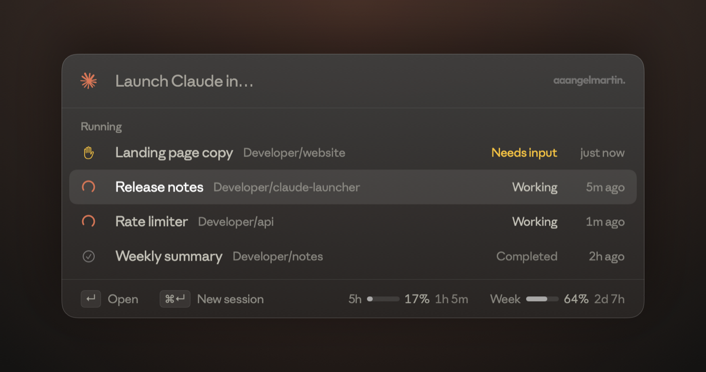
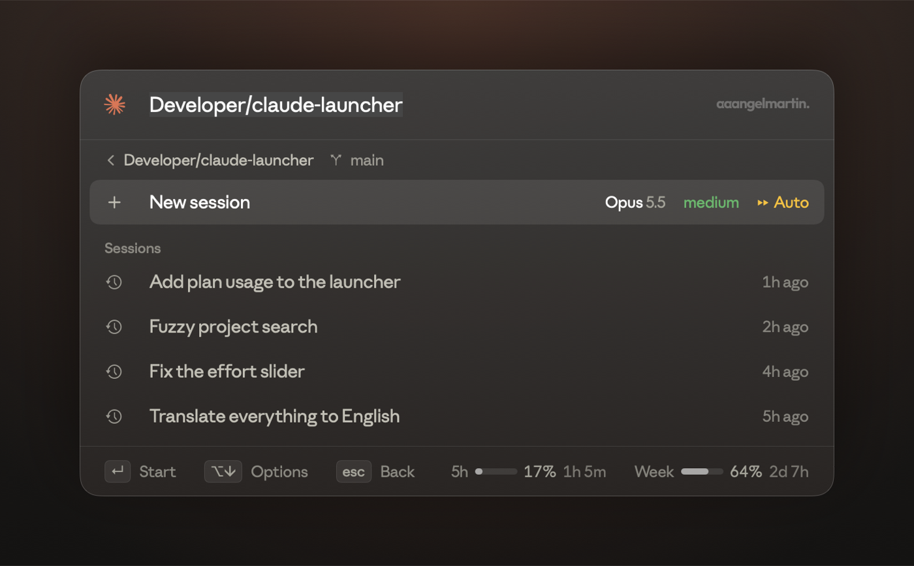
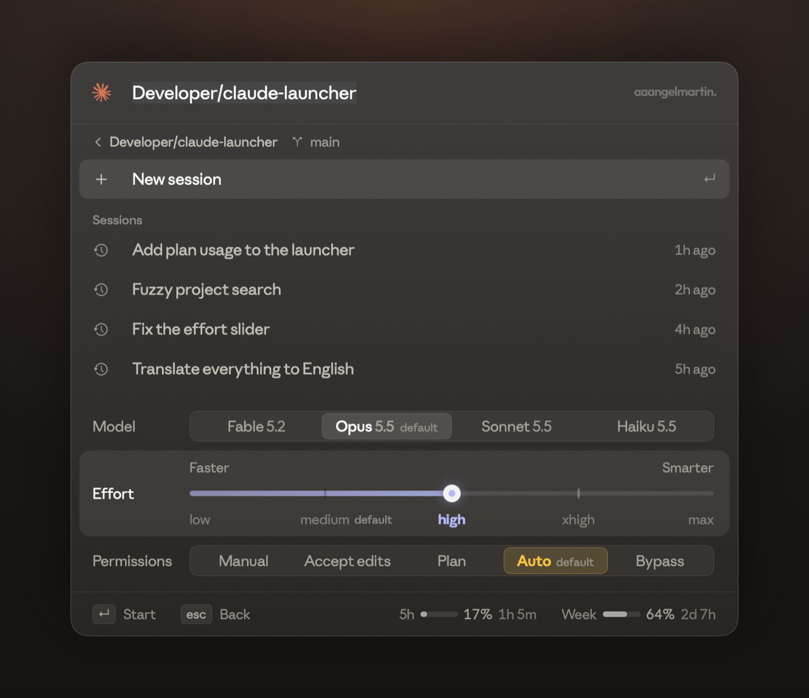
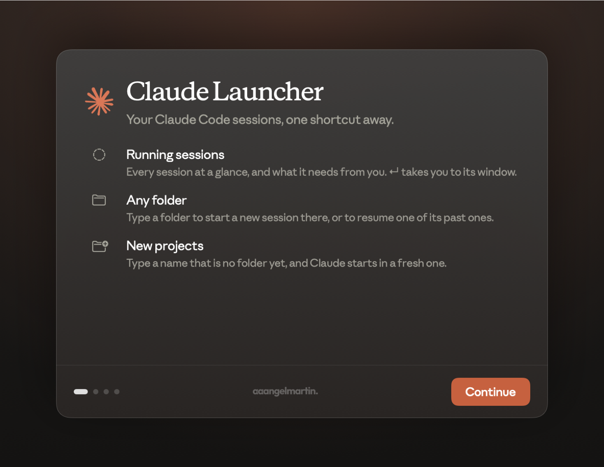

<p align="center">
  
</p>

<p align="center">
  <a href="https://github.com/aaangelmartin/claude-launcher/releases/latest"></a>
  
  <a href="LICENSE"></a>
</p>

# Claude Launcher

> [!NOTE]
> **Unofficial, independent project.** Claude Launcher is made by Ángel Martín. It is not affiliated with, endorsed, sponsored or supported by Anthropic. Claude, Claude Code and Anthropic are trademarks of Anthropic, PBC.

One shortcut for Claude Code on your Mac. Press **⌥C** anywhere to see every Claude Code session running right now and what it needs from you, or type a folder to start a new session there or resume one of its past ones.



## Install

```sh
brew install --cask aaangelmartin/tap/claude-launcher
```

Then open **Claude Launcher** from Applications. The first launch walks you through a short setup: it checks that Claude Code is installed, asks for permission to control Terminal, and lets you pick your shortcut.

### Requirements

| | |
|---|---|
| **macOS 14** or later | Apple silicon or Intel |
| **[Claude Code](https://claude.com/claude-code)** | the `claude` CLI, signed in |
| **[Claude app](https://claude.ai/download)** | needed for the look: Claude Launcher uses Anthropic Sans and Anthropic Serif from it. Without it, the system fonts are used |

## How it works

Each moment has one purpose:

1. **Opened**: every Claude Code session running now, with its state. **↵** brings its Terminal tab forward.
2. **Typing**: folders to start or resume a session in, the best match already highlighted.
3. **A folder** (**↵** on it): **New session**, already highlighted, then the sessions running there and its past ones to resume.



**Starting a new project?** Type a name that is no folder yet, like `my-next-app`, and the last line offers **Create folder**, showing where it would go: a bare name under `~/Developer` (or your home folder without one), a path exactly as typed. It sits apart, under **New project**, and is already highlighted when nothing else matches. **↵**, your shortcut or **⌘N** (from anywhere while typing) creates it and starts Claude in it.

**Press your shortcut again** to start a new session at once: in the folder you are in, the highlighted one, or your home folder. Type `laaabs`, press ⌥C, and Claude starts there.

### Session states

Running sessions show the states Claude's Code view filters by:

| State | Means |
|---|---|
| ✋ **Needs input** | it stopped on a question or a permission, and waits for you |
| ◠ **Working** | Claude is working on it right now |
| ✓ **Completed** | its turn is over; it waits for your next message |

What needs you comes first.

### Launch options

When a session starts or resumes, a row above the bottom bar shows how: **model**, **effort** and **permissions**. **⌥↓** (or a click on a value) opens them. The bottom bar itself always says what the keys do where you are, with your plan use on the right.



- **Model**: Fable, Opus, Sonnet, Haiku, with the numbers read from your installed `claude`, so they update with it.
- **Effort**: low to max. The level each model starts with is marked *default*.
- **Permissions**: Manual, Accept edits, Plan, Auto, Bypass. The mode your settings choose is marked *default*.

They start from the defaults every time, and picking a default adds no flag, so Claude keeps following its own settings.

### Plan use

On the right of the bottom bar, everywhere: your five-hour session and weekly use, as `/usage` shows them, with the time left until each resets. They turn yellow from 80 % and red from 95 %.

## Keys

| Key | Does |
|---|---|
| **⌥C** | bring up Claude Launcher; again, start a new session at once |
| **↑ ↓** | move through the list |
| **↵** | go to a running session, open a folder, create a new one, start or resume a session |
| **⌘↵** | start a new session at once |
| **⌘N** | create the folder typed and start Claude in it |
| **Tab** | highlight the first line; on a folder, complete its path |
| **⌥↓ ⌥↑** | open and fold the launch options |
| **esc** | back out one step: the folder, what is typed, then the window |
| **⌘,** | the setup again (shortcut, checks) |
| **⌘Q** | quit |

A path works too: `~/projects/my-app`, `/Volumes/disk/work`, completed with **Tab**.

## Setup



1. **Welcome**: what Claude Launcher does.
2. **Check your setup**: Claude Code installed and its version, permission to control Terminal, Claude Code signed in (for the plan use), the Claude app (for its fonts), and start at login.
3. **Your shortcut**: pick it; ⌥C by default.
4. **You're set**: press it to begin.

## Privacy

Everything stays on your Mac, except one request for your plan use:

- **Running sessions** are read from `~/.claude/sessions`, where Claude Code keeps a record of each live session.
- **Past sessions** are read from `~/.claude/projects`: only the start and end of each file, for its folder and title.
- **Plan use** is asked from Anthropic's API, the same request `/usage` makes, with the sign-in Claude Code keeps in your keychain. macOS asks you once before Claude Launcher can read it. It is only read, never refreshed or stored, and nothing else is sent anywhere.
- **Terminal** is controlled with Apple Events to open a window and run `claude` in it; macOS asks you first.

## Build from source

Requirements: Xcode with Swift 6.2 or later, and the laaabs. kit next to it (`Package.swift` points at it with `path:`).

```sh
git clone https://github.com/aaangelmartin/claude-launcher
cd claude-launcher
./scripts/install.sh        # build, sign and install in ~/Applications
swift test                  # the tests
```

`scripts/release.sh` builds the notarized zip that the Homebrew cask installs, and `DOCS_DIR=docs swift test --filter DocsImages` redraws this readme's images from the app's own views. Changes are listed in the [changelog](CHANGELOG.md).

## Uninstall

```sh
brew uninstall --cask claude-launcher
```

Remove it from System Settings → General → Login Items if it is still listed.

## Legal

Claude Launcher is an unofficial, independent project by Ángel Martín. **I am not affiliated with Anthropic**, and this app is not made, endorsed, sponsored or supported by Anthropic in any way. "Claude", "Claude Code" and "Anthropic" are trademarks of Anthropic, PBC, used here only to say what this app works with. For help with Claude or Claude Code themselves, go to [Anthropic's support](https://support.anthropic.com), not to this project.

- **Fonts**: Anthropic Sans and Anthropic Serif are Anthropic's typefaces. They are not in this repository or in the app; Claude Launcher loads them from your installed [Claude app](https://claude.ai/download) while it runs.
- **The Claude mark** in the window and the icon is Anthropic's, and remains theirs.
- **The aaangelmartin wordmark** belongs to Ángel Martín and is not licensed for reuse.

The code is released under the [Apache License 2.0](LICENSE); see [NOTICE](NOTICE) for the third-party material it does not cover.

<p align="center">
  <br>
  <a href="https://aaangelmartin.com">
    <picture>
      <source media="(prefers-color-scheme: dark)" srcset="Resources/aaangelmartin.svg">
      
    </picture>
  </a>
</p>
